# Architecture for review

## User workflow

```mermaid
flowchart LR
  Project[Create or select project] --> Method[Exact methodology version or unassigned]
  Method --> Module[Compatible module version or generic intake]
  Module --> Roles[Inspect defined file roles]
  Roles --> Template[Download module template]
  Template --> Upload[Upload and validate inputs]
  Upload --> Preview[Leakage arithmetic preview when supported]
  Preview -. Future .-> Review[Verify evidence and eligibility]
  Review -. Future .-> Run[Persist formal calculation run]
  Run -. Future .-> Results[Verified report]
```



The solid-arrow workflow is available for the limited VMD0054 single-commodity pilot. Generic intake only stores and checks files. VM0047 v1.0 is listed as an unreviewed methodology reference; assigning it does not establish project eligibility. See [pilot scope](leakage-pilot.md).

## Boundaries

```text
React + TypeScript (browser)
    -> /api (Vite proxy locally; Nginx in Compose)
    -> FastAPI routes and Pydantic response schemas
    -> project service / code-defined catalogue / workbook service
    -> SQLAlchemy session -> PostgreSQL projects and workbook metadata
    -> private upload directory -> immutable original bytes
```

This is a modular monolith: one API process and one database, with a small static frontend. `app/api` translates HTTP; `app/schemas` defines public metadata; `app/services` owns the upload use case; `app/models` and `app/db` own persistence; `app/core` holds configuration and errors. Alembic changes the schema explicitly. There are no speculative calculation tables or extension frameworks.

| Logical boundary | Current implementation |
| --- | --- |
| Project management | `services/projects.py`, project schemas/model and scoped routes |
| Methodology/version catalogue | Explicit `METHODOLOGIES` tuple in `catalogue.py`; VM0047 v1.0 is listed as unreviewed |
| Module definitions | `MODULES` tuple with stable ID/version, kind, availability, exact compatibility and file roles |
| File storage and metadata | Existing streaming workbook service plus non-null project ownership |
| Workbook-format adapters | Versioned layout readers for generic intake and the Leakage pilot; arbitrary project workbooks are not calculation inputs |
| Input validation | Basic package checks for every upload; typed cells, years, units and bounds for the Leakage pilot; source evidence is not verified |
| Calculation execution | Pure single-commodity Leakage preview in `services/leakage.py`; formal `/runs` remains unavailable |
| Results/reporting | Preview JSON and downloadable text summary; no persisted run or verified report |

A **project** identifies a real-world undertaking; the legacy collection is explicitly only a preservation container with ownership yet to be established. A **methodology version** identifies an exact ruleset, not a project or a support claim. A **module version** is a particular capability and compatibility declaration, not a shared module name interpreted as identical rules. A **file adapter** will read an explicitly supported layout into a versioned input contract, independently of which project supplies it. A **run** will bind these exact identities to confirmed input data and implementation versions; none is created yet.

The registry is ordinary Python data. It never imports user-supplied code or stores formulas in the database. Availability distinguishes unavailable, intake-only, prototype preview and calculation-ready. The current definition validator rejects calculation-ready registrations because full execution does not exist. Methodology-independent definitions are permitted only for utilities. Catalogue entries can be labelled unreviewed; catalogue listing alone never establishes VCS compliance.

React supports reusable forms, status messages, tables, and metadata panels that can later support comparison interfaces. TypeScript checks frontend data use at build time. Types alone do not validate network responses: Zod validates the API payload at runtime, and Pydantic validates backend responses. Changes to these parallel contracts should be reviewed together; generated client types can be considered once the API stabilizes.

The browser has real loading, unavailable, empty, success, and error states. API status checks process health; database failures appear as actionable library/upload errors. Metadata is fetched from its own endpoint. Pagination limits metadata queries. Leakage preview results are clearly labelled and bound to a stored source checksum.

`App.tsx` owns project selection; `Workspace.tsx` owns the selected project's methodology, module, file list and metadata. The workspace is keyed by project UUID so file/metadata state is discarded when switching projects. Responses from a previous project's assignment cannot replace the newly selected project. All file API requests carry the project ID. The API rechecks ownership rather than trusting that client context.

## Upload lifecycle

1. Limit the raw HTTP request before multipart parsing can spool unlimited data. Starlette may temporarily spool accepted multipart data to the operating-system temporary directory.
2. Resolve and lock the owning project, validate any exact module/version/file-role association and compatibility, then validate the original filename; generate a UUID for private storage independent of the name. Generic intake requires no module association. Defined roles describe only their code-configured module version. Completed template roles check the versioned Inputs layout before the metadata commit and return cell-level errors when invalid. The Leakage role also checks numeric inputs and year sequence.
3. Stream bytes into storage in 64 KiB chunks, enforcing size and computing SHA-256.
4. Inspect the ZIP in place without extraction. Bound member count, total expanded size, and per-member compression ratio; stream every member to verify CRC and actual sizes. Reject encryption, traversal, symlinks, duplicate members, malformed archives, known macro and embedded active content, and invalid required XML parts. Parse required XML with defusedxml to reject entity-based attacks.
5. Flush and refresh the new metadata, then commit. Return `stored` only after commit. Handled failures roll back and remove the new file, including failures during database flush/commit. Separate uploads always have separate records/files.

Synchronous route handlers run in FastAPI's thread pool, so ZIP parsing, hashing, filesystem writes, and synchronous SQLAlchemy calls do not run on the asynchronous event loop. The request body is bounded before parsing; the service also enforces the exact file limit. This is a small-file local design; it does not claim high concurrency or full Office-package validation. External links are not refreshed, formulas are not evaluated, and macros are never executed.

Metadata and original bytes have separate storage lifecycles. The application never stores uploads in the frontend public directory and exposes no download path. SQLAlchemy parameterizes database access. Public errors omit internal paths and exception details. Local ports bind only to loopback; API CORS is not opened.

## Consistency and testing

PostgreSQL is the only application database. Readiness checks connectivity and access to the project and metadata tables, which catches missing migrations. No schema is automatically created at API startup. Compose explicitly runs Alembic before serving. Only one migration runner is intended in this local setup.

Migration `0002` creates projects and gives every existing workbook the reserved legacy collection ID without changing its original fields or storage location. New workbook records require a project foreign key (`ON DELETE RESTRICT`); partial methodology/module contexts are rejected by check constraints. Module definitions remain code-defined and are revalidated by the API, not represented by speculative catalogue tables. Both assignment changes and file intake lock the same project row. Methodology changes are rejected when methodology-specific or unknown module associations exist; known methodology-independent utility files allow later assignment; no API reparenting of files is offered. These are integrity controls, not user authorization. Downgrading to `0001` preserves original workbook fields but discards project/association context; back up before any downgrade.

Pure tests cover package validation, filenames, exact catalogue matching and readiness guards. Service failure tests inject database/storage failures to check cleanup; they do not claim to verify PostgreSQL transactions. HTTP tests cover readiness, consistent errors, and request-size enforcement. Real PostgreSQL tests check data-preserving migration from `0001`, owner foreign keys, cross-project metadata denial, assignment persistence, compatibility, role validation and unavailable execution. Synthetic methodology/module fixtures exist only in tests, never in the production catalogue. CI supplies PostgreSQL. Frontend component tests use mocked API responses to verify project switching, role selection, uploads and disabled actions; those are UI tests, not database integration. A real HTTP proxy smoke check verifies Vite-to-API routing when available. Browser visual/interaction checks remain separate from all of these.

The filesystem and database are not one atomic resource. Ordinary failures are compensated; abrupt termination or uncertain commit outcomes still need a reconciliation strategy. A production implementation should track durable upload state, reconcile missing/orphaned files, and test recovery procedures rather than promising perfect atomicity.

## Future work

The pilot calculation is pure and separate from HTTP handlers, Excel-reading adapters, and persistence. Before formal execution, review its exact applicability and input evidence against trusted project fixtures, add unsupported commodity and project cases, and define immutable run records with provenance, units, rounding and verification status.

### Adding a future module

1. Obtain and review an authoritative methodology identifier, exact version, requirements and expected outputs. Add a catalogue entry with an honest review status; do not label it supported because its name appears in a list.
2. Define a stable module identifier/version with explicit compatible methodology pairs. Start unavailable, or intake-only if actual file collection roles/formats are defined. Do not reuse a name as proof of equivalent rules.
3. Define a versioned input contract including units, required values, provenance and validation rules. Implement a layout adapter and explicit domain validator with trusted workbook fixtures. Adapter/package success must remain distinguishable from valid domain inputs.
4. Implement calculation functions consuming only that contract, without Excel access, HTTP calls or persistence. Verify against agreed reference results, edge cases, units and rounding rules.
5. Only after executable adapter, validation, calculation and verification exist should the readiness guard and execution boundary be extended to register that code. Define recovery, run persistence and reporting for that concrete use case; do not turn on a ready label alone.

The same future calculation can accept multiple layouts through different adapters producing the same input contract. For example, layout-specific column/sheet mappings belong in adapters, while calculation functions consume named, validated values. Adapter selection must be explicit and recorded, never inferred from the project name. The current optional adapter field is unimplemented; expand its representation only when real layouts and a concrete selection policy exist. No project-specific application forks are required.

### Future calculation-run contract (documentation only)

Before persisting or executing real runs, specify an immutable record containing:

- Run ID and owning project ID.
- Methodology identifier and exact version, plus the reviewed rule/reference identity.
- Module identifier and version, exact adapter identifier/version and input-contract version.
- Source-file IDs, owning project IDs, SHA-256 checksums and assigned file roles; reject sources owned by another project.
- Confirmed input snapshot, units, rounding policy, provenance back to source sheet/cell where available, confirmation timestamp and eventual confirming-user identity.
- Calculation implementation version (for example a reviewed release and source revision) and dependency lock/environment identity.
- Status, creation/start/completion timestamps, relevant validation messages with severity/codes/source references, and structured results/report artifact identifiers when execution actually completes.

Keep original sources immutable; a replacement upload has a new file ID. Archive the exact definitions and validated input snapshot used so later catalogue edits cannot reinterpret an earlier run. New methodology/module/adapter versions must not silently replace earlier ones. These requirements are intentionally not implemented as unused tables or an execution subsystem in this milestone.

Before multi-user deployment, review authentication, per-file authorization, tenancy, quotas, CSRF/origin protections appropriate to the chosen credentials, malware scanning, audit trails, TLS, secrets management, dependency patching, and backup/restore. Do not treat a loopback development deployment as a production security design. A user with access to the local host can access this unauthenticated API.

For larger files or concurrent usage, consider a bounded worker pool, isolated package inspection, direct object-storage uploads with validation states, durable jobs, and resource limits. Add infrastructure only when concrete workload and recovery requirements justify it. For deployment, build immutable images, restrict filesystem permissions, pin reviewed image/dependency versions, and coordinate migrations as a separate release step. PostgreSQL metadata and file storage must be backed up and restored consistently.

## Questions for John

- Are these module boundaries sufficient for the next narrowly scoped feature?
- Is the explicit catalogue and exact-version compatibility model simple enough?
- Do the project foreign key, legacy preservation container and separate file storage fit the intended workflow?
- Does the division between mocked UI tests, pure/service tests and PostgreSQL integration tests support maintainability?
- Should upload records gain explicit validation/recovery states before calculations begin?
- Is keeping duplicates useful for review, or should the API expose duplicate warnings?
- Which file-security policy and integration fixtures best reflect the real workbook collection?
- Which authentication, file-isolation and scaling priorities should precede multi-user deployment?
- What is the smallest useful next milestone with an agreed acceptance test?
